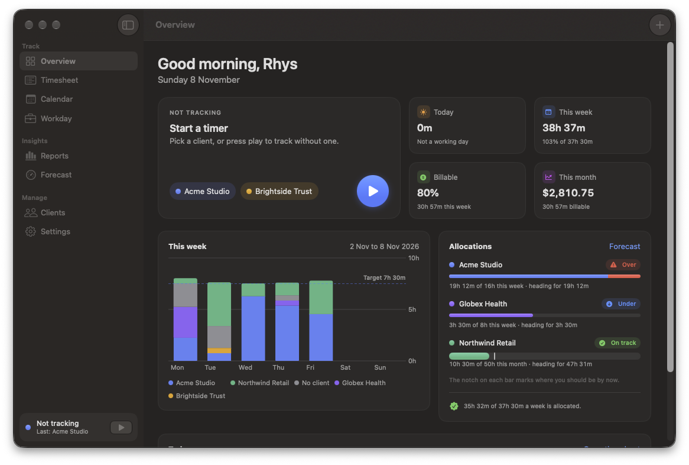
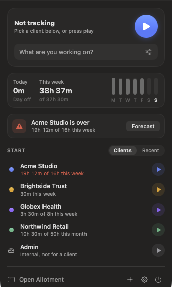

# Allotment

A macOS menu bar time tracker for client work. Start a timer for a client in one click, and see at a glance whether each client is heading over or under the hours they booked.



## What it does



- **Menu bar timer.** Start, stop and switch clients from the menu bar. The stopwatch icon ticks while a timer runs, so you always know you are tracking.
- **Allocations and forecasts.** Give each client a weekly or monthly allocation. Allotment shows where you should be by now, and warns you when a client is heading over or under.
- **Calendar.** Meetings from the calendars on your Mac, including Google and Outlook accounts, become time entries in one click.
- **Admin time.** Track internal work, such as email and planning, without a client.
- **Reports and exports.** Totals by client, project and activity, with exports to Excel, CSV and PDF.
- **Workday.** A timesheet laid out ready to enter in Workday, a spreadsheet for a Workday admin, or a direct sync through the Workday API.
- **Idle time.** When you step away with a timer running, Allotment asks whether to keep that time.

<br clear="right">

## Private by design

Everything is saved in one file on your Mac. There is no account and no server. Allotment reads your calendar but never changes it. It keeps Workday secrets in your Keychain and only connects to Workday when you test the connection or send time.

## Requirements

- macOS 26 or later
- Xcode with the macOS 26 SDK (Allotment is developed with Xcode 27.2)
- [XcodeGen](https://github.com/yonaskolb/XcodeGen), which creates the Xcode project from `project.yml`

## Build and run

```bash
brew install xcodegen
xcodegen generate
open Allotment.xcodeproj
```

In Xcode, choose the Allotment scheme and press Run. Allotment lives in the menu bar, so look for the stopwatch icon at the top of the screen.

To build from the command line instead:

```bash
xcodebuild -project Allotment.xcodeproj -scheme Allotment -configuration Release build
```

## Try it with sample data

Run Allotment with the `--demo` argument to explore a few weeks of sample clients and time. Sample data stays in memory, so your own data is never touched. Add `--show-window` to open the main window straight away. In Xcode, add both under Product › Scheme › Edit Scheme › Run › Arguments.

## Tests

```bash
xcodebuild -project Allotment.xcodeproj -scheme Allotment test
```

## Sending time to Workday

The Workday timesheet and the admin spreadsheet only need your clients and activities matched to Workday's time entry codes and projects, which you do once in Allotment's Workday setup. To send time straight to Workday as well, ask your Workday admin to register an API client for Allotment with:

- the Authorization Code grant
- the redirect URI `allotment://workday/callback`
- the Time Tracking and Staffing scopes
- refresh tokens turned on

Then enter the client ID, client secret and endpoints in Allotment's Workday setup.
